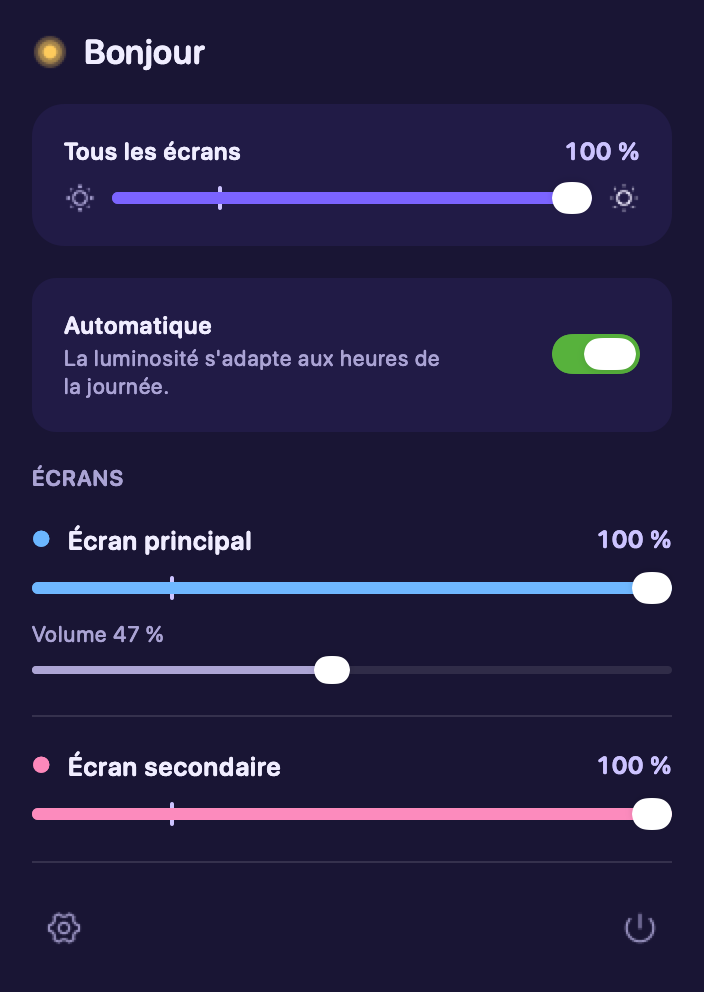
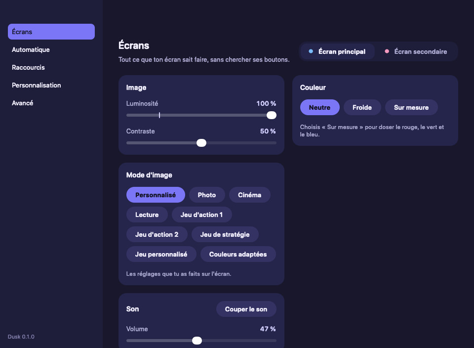
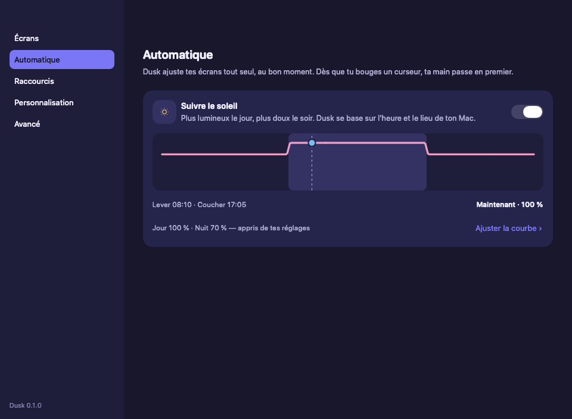
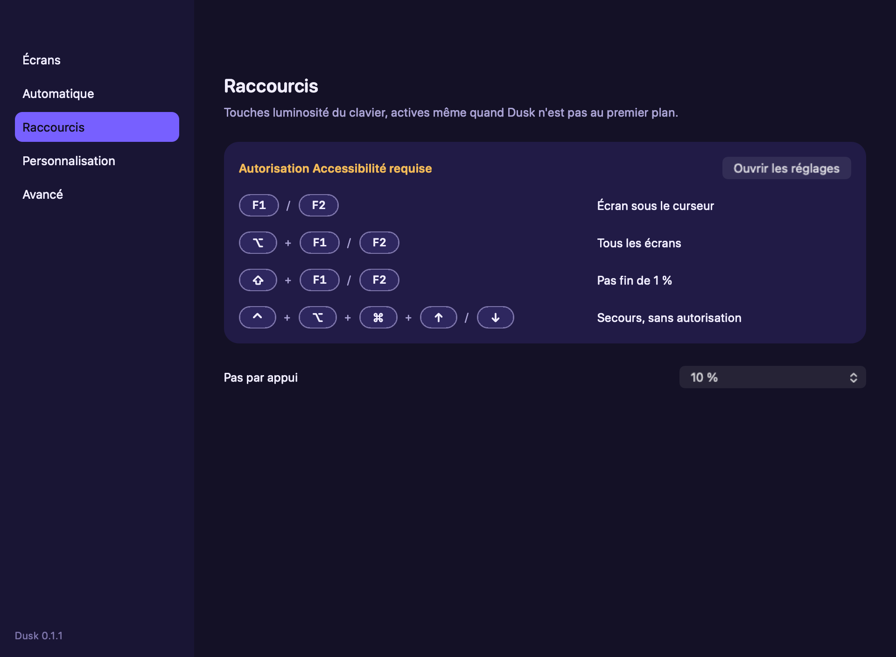

# Dusk

**Tous les boutons de ton écran, dans la barre des menus du Mac.**

Pilote tes écrans depuis la barre des menus : luminosité, couleur, entrée, son et plus, automatiquement au fil de la journée.

<p align="center">
  
</p>

Dusk parle à tes écrans externes comme le font leurs propres boutons (DDC/CI) : la luminosité change dans la dalle elle-même, pas avec un voile gris par-dessus. Il gère aussi tout ce que l'écran sait faire, s'adapte au fil de la journée, et sait se faire oublier.

*[English version](README.md)*

## Ce qu'il fait

- **La luminosité de chaque écran** depuis la barre des menus et avec les touches de luminosité du clavier. Avec ⌥, tous les écrans bougent ensemble, chacun gardant son écart avec les autres.
- **Plus sombre que le minimum** : sous 0 %, Dusk assombrit encore l'image, pour les soirées tardives.
- **Les écrans que Dusk ne peut pas piloter** (téléviseurs, Sidecar, adaptateurs DisplayLink) ont quand même un curseur de luminosité qui marche : Dusk assombrit l'image à leur place.
- **Automatique** : plus lumineux le jour, plus doux le soir, d'après le fuseau horaire du Mac (sans demander ta position). Sur un Mac équipé d'un capteur de lumière, il suit plutôt la lumière de la pièce. Chaque réglage à la main est retenu pour ce moment de la journée.
- **Tout ce que ton écran sait faire**, sans chercher ses boutons : mode d'image, couleur et RVB, entrée, netteté, langue des menus, son, alimentation, réglages d'usine. Seuls les réglages que ton écran accepte sont affichés.
- **Trois thèmes**, clair et sombre, en français et en anglais.

<p align="center">
  
</p>

<p align="center">
  
</p>

<p align="center">
  
</p>

## Configuration requise

- Un Mac Apple Silicon (M1 ou plus récent)
- macOS 14 Sonoma ou plus récent
- Des écrans compatibles DDC/CI pour le contrôle matériel (la plupart le sont ; c'est souvent une option dans le menu de l'écran)

## Installation

1. Télécharge `Dusk.zip` depuis la [dernière version](../../releases/latest) et place `Dusk.app` dans ton dossier Applications.
2. Ouvre-le. Dusk n'est pas encore notarisé par Apple, donc macOS bloque le premier lancement. Va dans **Réglages Système › Confidentialité et sécurité**, descends et clique sur **Ouvrir quand même**. Une seule fois suffit.
3. Pour utiliser les touches de luminosité du clavier, autorise Dusk dans **Réglages Système › Confidentialité et sécurité › Accessibilité** (Dusk propose d'y aller pour toi).

Ensuite, Dusk se met à jour tout seul : il vérifie une fois par jour et installe les nouvelles versions en silence quand il se ferme. Si tu as la version 0.1.0, télécharge une fois la dernière version à la main ; tout est automatique ensuite.

Ou avec [Homebrew](https://brew.sh) : `brew install --cask pierrefardel/dusk/dusk` (le premier lancement demande le même passage par **Ouvrir quand même**).

## Compiler soi-même

```sh
./scripts/bundle.sh   # construit dist/Dusk.app (release, icône, signature)
open dist/Dusk.app
```

Il faut Rust (stable) et les outils en ligne de commande de Xcode.

Un outil en ligne de commande est fourni :

```sh
cargo run -p dusk-cli -- list          # écrans détectés et façon de les piloter
cargo run -p dusk-cli -- get all       # luminosité actuelle
cargo run -p dusk-cli -- set 0 60      # écran 0 à 60 %
cargo run -p dusk-cli -- vcp 0 0x12    # lecture d'un code VCP brut (ici le contraste)
```

`DUSK_DEBUG=1` affiche les trames DDC brutes.

## Vie privée

Dusk ne collecte rien et ne se connecte jamais à Internet. Tes réglages restent dans `~/Library/Application Support/Dusk`.

## Licence

[MIT](LICENSE). Icônes par [Hugeicons](https://hugeicons.com) (MIT, voir `assets/icons/LICENSE-hugeicons.md`).
