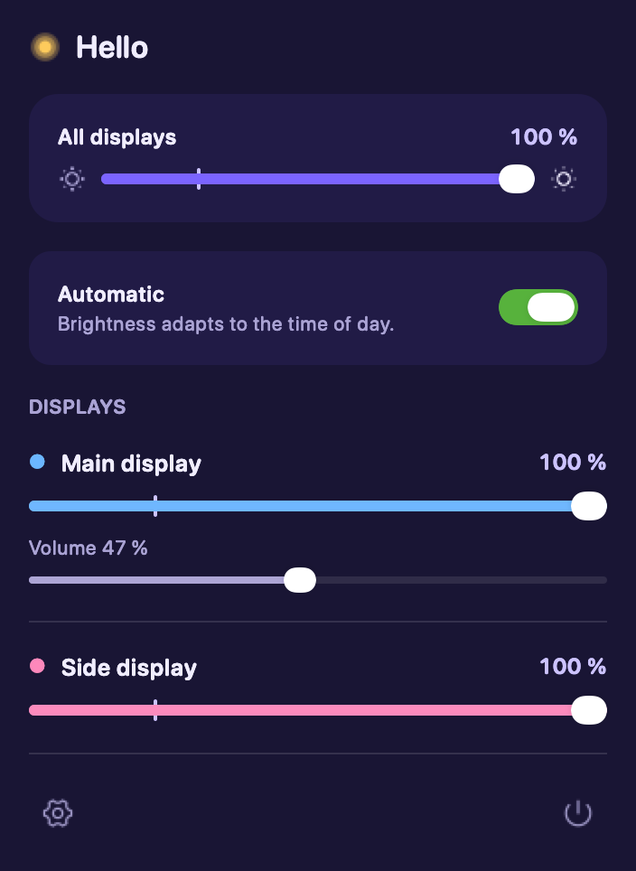
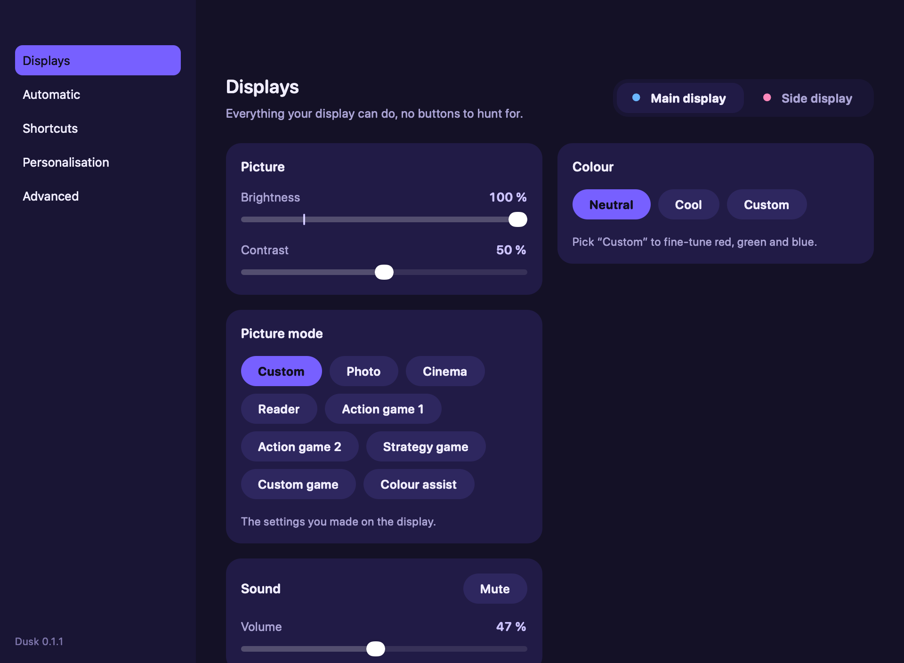
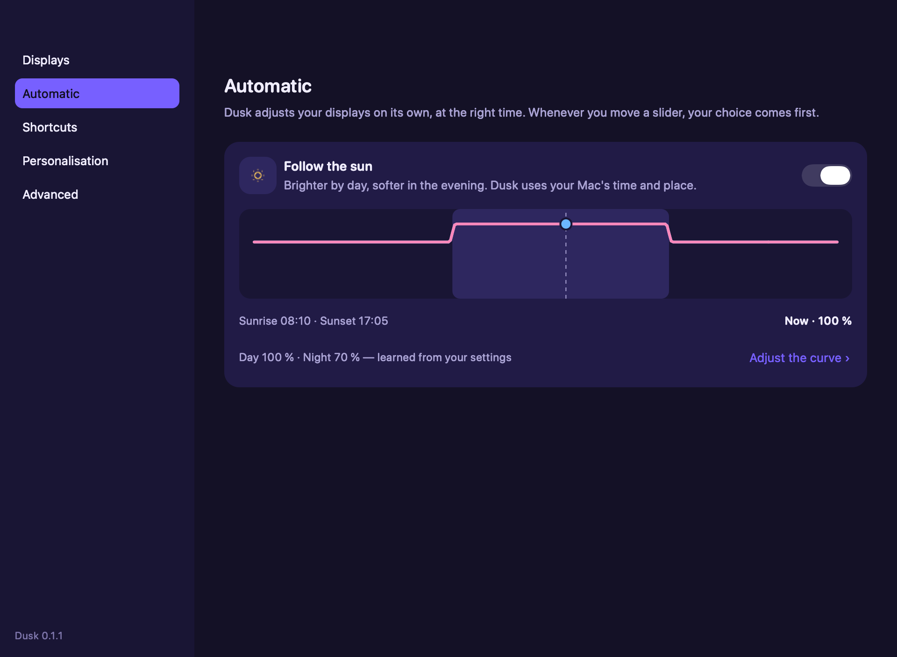
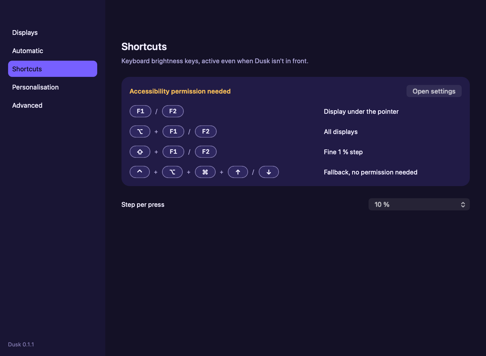

# Dusk

**Every button on your monitor, in your Mac's menu bar.**

Control your displays from the menu bar: brightness, colour, input, sound and more, automatically through the day.

<p align="center">
  
</p>

Dusk talks to your external displays the way their own buttons do (DDC/CI), so brightness changes on the panel itself instead of a grey overlay. It also handles the rest of what a display can do, adjusts itself through the day, and stays out of your way.

*[Version française](README.fr.md)*

## What it does

- **Brightness for each display** from the menu bar and with your keyboard's brightness keys. Hold ⌥ to move all displays together: each one keeps its gap with the others.
- **Darker than the minimum**: below 0 %, Dusk dims the picture further for late nights.
- **Displays Dusk can't talk to** (TVs, Sidecar, DisplayLink adapters) still get a working brightness slider: Dusk dims the picture for them.
- **Automatic**: brighter by day, softer in the evening, based on your Mac's time zone (no location access). On Macs with a light sensor, it follows the room light instead. Every manual change is remembered for that moment of the day.
- **Everything your display can do**, without hunting for its buttons: picture mode, colour and RGB, input, sharpness, on-screen menu language, sound, power, factory reset. Only the settings your display accepts are shown.
- **Three themes**, light and dark, in English and French.

<p align="center">
  
</p>

<p align="center">
  
</p>

<p align="center">
  
</p>

## Requirements

- A Mac with Apple Silicon (M1 or later)
- macOS 14 Sonoma or later
- Displays that support DDC/CI for hardware control (most do; it's often a setting in the display's own menu)

## Install

1. Download `Dusk.zip` from the [latest release](../../releases/latest) and move `Dusk.app` to your Applications folder.
2. Open it. Dusk isn't notarized by Apple yet, so macOS blocks the first launch. Go to **System Settings › Privacy & Security**, scroll down and click **Open Anyway**. You only do this once.
3. To use the keyboard's brightness keys, allow Dusk in **System Settings › Privacy & Security › Accessibility** (Dusk offers to open it for you).

Dusk then updates itself: it checks once a day and installs new versions quietly when it quits. If you have version 0.1.0, download the latest version once by hand; updates are automatic from then on.

Or with [Homebrew](https://brew.sh) (it asks you to trust third-party taps; the first launch needs the same **Open Anyway** step):

```sh
brew tap pierrefardel/dusk
brew trust pierrefardel/dusk
brew install --cask dusk
```

## Build from source

```sh
./scripts/bundle.sh   # builds dist/Dusk.app (release, icon, signature)
open dist/Dusk.app
```

Requires Rust (stable) and the Xcode command line tools.

A command-line tool is included:

```sh
cargo run -p dusk-cli -- list          # detected displays and how they're controlled
cargo run -p dusk-cli -- get all       # current brightness
cargo run -p dusk-cli -- set 0 60      # display 0 to 60 %
cargo run -p dusk-cli -- vcp 0 0x12    # read a raw VCP code (here: contrast)
```

`DUSK_DEBUG=1` prints raw DDC frames.

## Privacy

Dusk collects nothing and never connects to the internet. Your settings stay in `~/Library/Application Support/Dusk`.

## License

[MIT](LICENSE). Icons by [Hugeicons](https://hugeicons.com) (MIT, see `assets/icons/LICENSE-hugeicons.md`).
